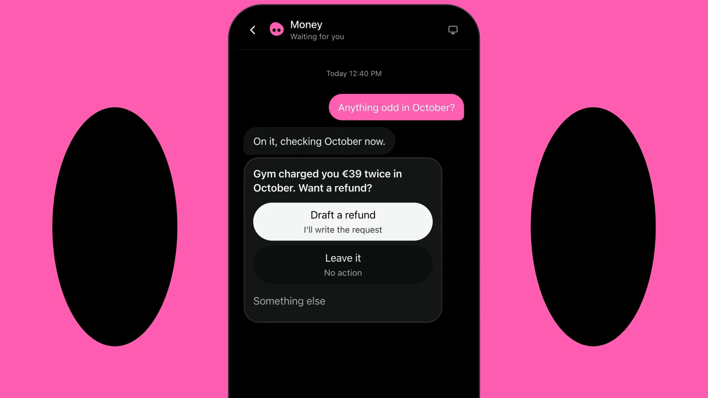
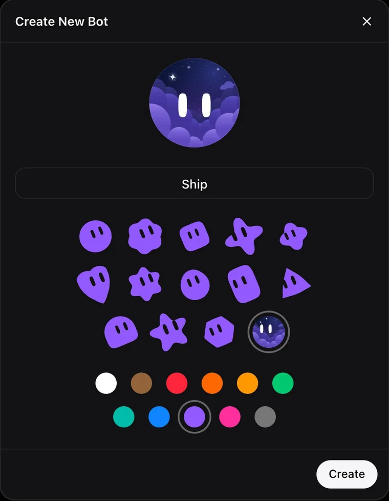
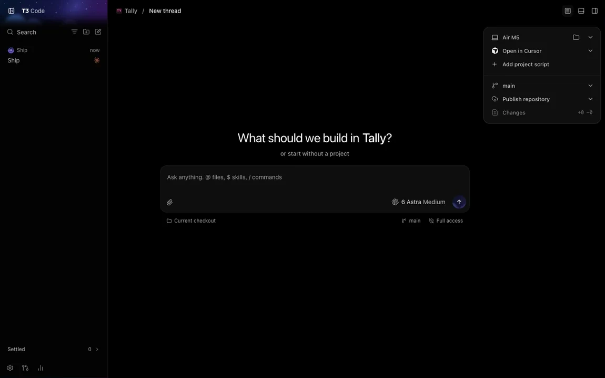
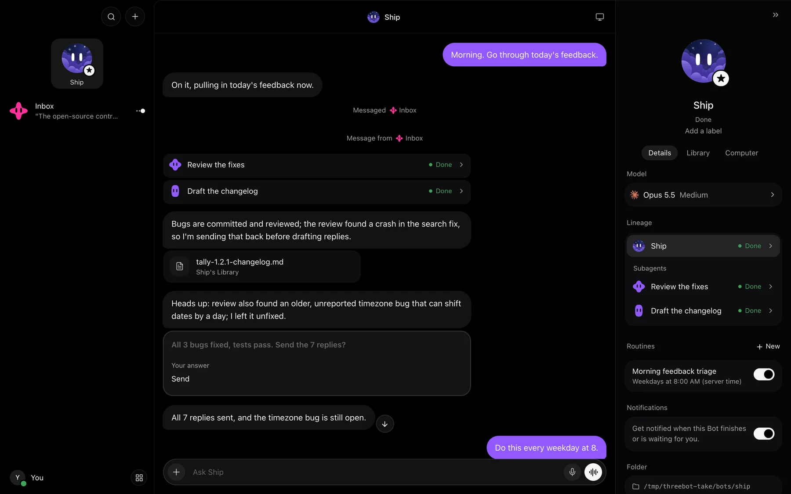
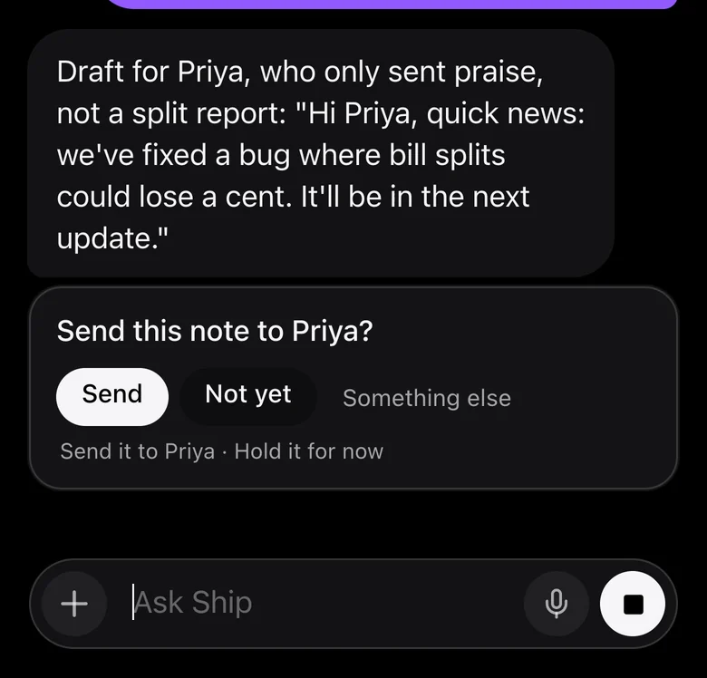
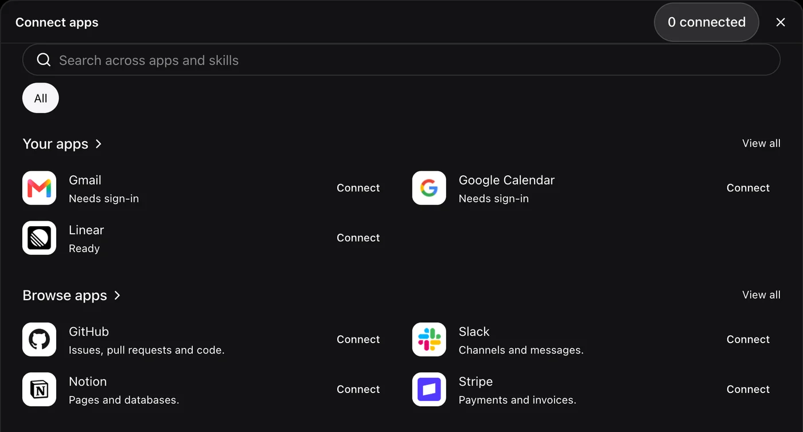
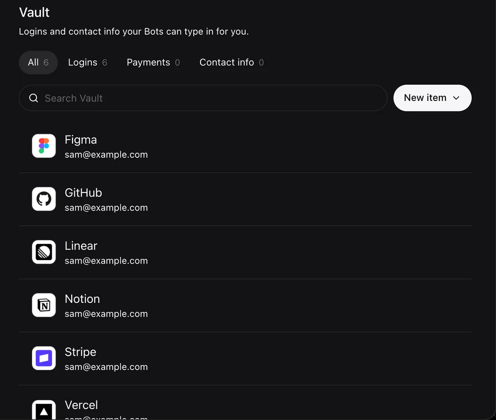
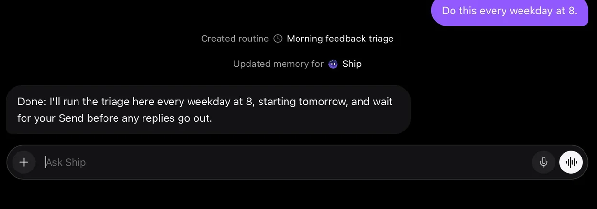
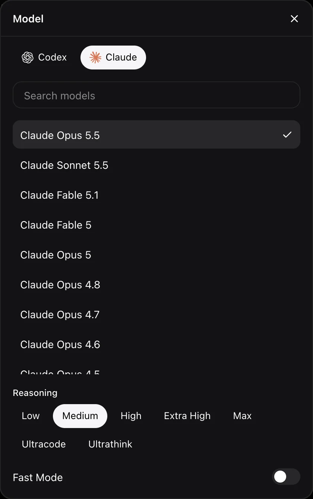

<p align="center"></p>

<h1 align="center">Threebot</h1>

<p align="center"><b>Your Bot is a T3 thread.</b><br />Personal agents on T3 Code, on your own subscriptions.</p>

<p align="center"><a href="https://bot.swk.tools/"><b>Website</b></a> · <a href="https://t3.codes">T3 Code</a></p>



You already have [T3 Code](https://github.com/pingdotgg/t3code) and the AI plan behind it. Threebot turns one long-lived T3 thread into someone you can message: a Bot with a face, a memory and a place on your phone. It does what a personal assistant does, faster, and runs your other threads for you.

Nothing new to pay for. Threebot doesn't resell AI; your Bots use the subscriptions T3 Code already has.

| First the Bot | Then its thread, with the same face |
|---|---|
|  |  |

| The desktop app | It asks on your phone |
|---|---|
|  |  |

| Connect your apps | A vault for its logins |
|---|---|
|  |  |

| Routines | Choose the model |
|---|---|
|  |  |

The screens are real runs on sample data.

## What's in it

**On top of T3 Code**

| In Threebot | In T3 Code |
|---|---|
| A Bot | A long-lived thread in its own project |
| Subagents | T3 subagents and delegated threads |
| Routines | Scheduled tasks |
| A Bot's computer | The T3 browser, with Take control |
| The model in Bot details | Your T3 providers |

Everything stays a normal T3 thread, so you can open any of it in T3 Code at any time.

**Added by Threebot**

- **A messaging app.** An installable PWA built for phones, with notifications, search and themes.
- **Memory.** Each Bot keeps a Markdown memory file it updates as it learns, plus one shared by all your Bots. You can read and edit both in the Memory tab.
- **Projects (beta, off by default).** One live board for everything you are working on: projects, to-dos, your machines and what runs on each, repos, notes and links, split into areas like work and personal. Bots read and edit it with their own tools, every change appears on your screen as it happens, and every item has a link you can hand to a Bot. Switch it on in Settings → Beta.
- **Vault.** Encrypted logins Bots can type into a site without reading the password, powered by secure requests from T3 Code.
- **Connected apps.** Gmail, GitHub, Slack and the rest, powered by [Executor](https://executor.sh), if you run it.
- **Independent Bots.** A Bot decides and acts on its own, then tells you what it did. It stops to ask only for what's yours to decide, like your money or your identity, and for anything on your Always Ask list. See [SECURITY.md](SECURITY.md).
- **A face.** The ball's weather tells you what it's doing: storms, aurora, a moon when it's asleep. Prefer an object? Pick one of 22 from [Open Bot Avatar](https://github.com/DominikScholz/open-bot-avatar) by Dominik Scholz, or ask your Bot to draw itself.

## Run it

You need [T3 Code](https://t3.codes) on the same machine, with a provider signed in, and Node 22.18 or newer.

```sh
curl -fsSL https://raw.githubusercontent.com/RokaSwK/threebot/main/install.sh | sh
threebot up
```

The installer downloads the latest [release](https://github.com/RokaSwK/threebot/releases), checks it against the release's SHA-256 sums and installs it in `~/.threebot`. `threebot up` asks T3 Code for a token, starts Threebot as a background service (launchd on macOS, systemd on Linux) and prints its address, <http://127.0.0.1:3780>. Open it and create your first Bot.

To use it on your phone, open **Settings → Remote access**:

- **Tailscale**, one click: a private `https://…ts.net` link only you can open, from your own devices.
- **Cloudflare**, one click after setting a password: a public `trycloudflare.com` link that works anywhere, with no Cloudflare account.
- **Your own domain with Google sign-in**, through Cloudflare Access: [the guide](docs/cloudflare-access.md).

**Settings → Updates** shows new releases and installs them, like T3 Code: it downloads and checks the new version, restarts the service, and goes back to the old one if the new one doesn't start. From a terminal, run `threebot update`. `threebot help` lists the other commands.

**Settings → Usage stats** can share anonymous usage stats (versions, Bot and routine counts in ranges, and token counts per model). They are off unless you turn them on, and Settings shows the exact data before it's sent. [PRIVACY.md](PRIVACY.md) lists every field.

Threebot listens on `127.0.0.1` by default, with no sign-in. [docs/self-hosting.md](docs/self-hosting.md) covers the other ways to expose it.

### From source

```sh
git clone https://github.com/RokaSwK/threebot.git
cd threebot
npm run setup

cp .env.example .env
t3 auth session issue --ttl 30d --label threebot --token-only   # paste into T3_TOKEN
npm start
```

If T3 Code isn't on port 3773, set `T3_URL` in `.env`. A checkout updates with `git pull && npm run setup`.

A Bot is a T3 thread, so it runs on whatever T3 Code runs: Claude, Codex, Cursor, Grok Build, OpenCode, Antigravity, Muse Code, Pi, fx, ACP agents such as Hermes, and local models. Threebot is tested on Claude and Codex. Pi and Antigravity need one extra step to load the Bot's MCP tools; see [docs/harnesses.md](docs/harnesses.md).

## How it works

The browser app talks only to a small Node gateway, and the gateway talks to T3 Code. There is no database: a Bot is a folder with its config, memory and library, plus a T3 project and thread. The Projects board is one JSON file next to them, streamed to open pages as Server-Sent Events. See [docs/architecture.md](docs/architecture.md).

```sh
npm run check   # web tests, build, server tests, fixture and asset checks
```

## Status

Early, and built around one person's daily use. It needs T3 Code 0.1.6 or later. T3's API still moves, so expect things to break after a T3 update. Issues and pull requests are welcome.

## Credits

Threebot stands on [T3 Code](https://t3.codes) ([GitHub](https://github.com/pingdotgg/t3code)), made by T3 Tools Inc. and [its contributors](https://github.com/pingdotgg/t3code/graphs/contributors). The threads, subagents, scheduled tasks, browser, secure requests and MCP tools are all theirs. Thank you.

Connected apps run through [Executor](https://executor.sh). The type is [Rubik](https://fonts.google.com/specimen/Rubik). The film's music is "House Vibes" by Alejandro Magaña from [Mixkit](https://mixkit.co), with sound effects from Pixabay, made with [HyperFrames](https://hyperframes.heygen.com). The full list, including every open source library, is in [NOTICE](NOTICE).

Threebot is an independent project, not affiliated with or endorsed by T3 Tools Inc. MIT licensed; see [LICENSE](LICENSE).
